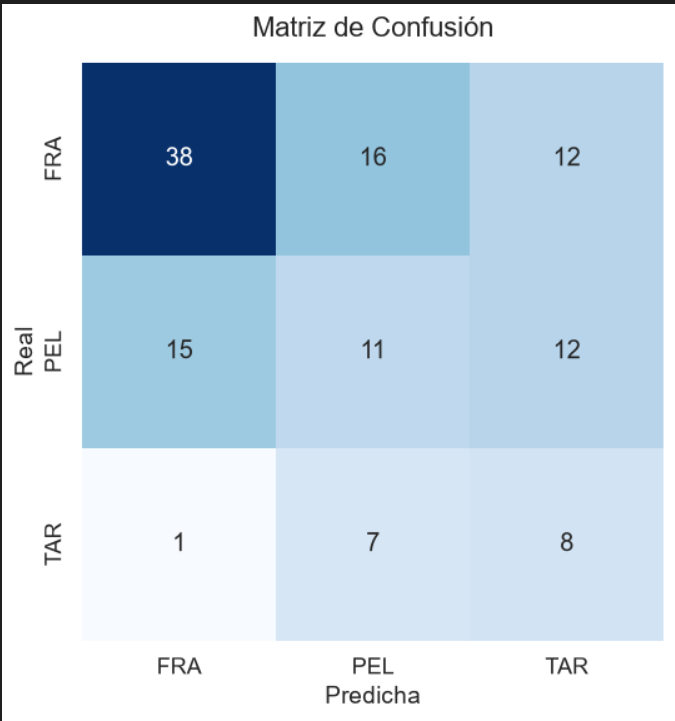

## Práctica 3. Detección y reconocimiento de formas

## Autores: José Miguel Ojeda Hernández (GitHub: https://github.com/JoseOjeda14) y Yenedey Morán Delgado (GitHub: https://github.com/Yenedey36)

## Tarea 1: Demostrador en vivo conteo y clasificación monetaria por geometría y calibración dinámica

En esta práctica desarrollamos un sistema en tiempo real utilizando OpenCV para detectar monedas mediante la Transformada Circular de Hough (cv2.HoughCircles), esta calcula una relación métrica de conversión píxeles/milímetros a partir de un fotograma inicial de referencia de la mesa y sumar de forma dinámica el valor monetario total en pantalla sin hacer uso de modelos de aprendizaje profundo.

Pasos técnicos de la implementación:

Captura estática inicial y calibración por eventos de ratón: Al arrancar el script, capturamos de forma dinámica el primer fotograma de la cámara para congelar la escena de la mesa con las monedas (img_ref). Mediante la función cv2.setMouseCallback, registramos un evento de clic izquierdo que detecta las coordenadas del usuario sobre una moneda concreta, permitiendo calcular la escala exacta de conversión al relacionar su radio en píxeles con su diámetro real en milímetros.

Preprocesamiento y detección en tiempo real (HoughCircles): En el bucle principal de vídeo fotograma a fotograma, transformamos la entrada a escala de grises y aplicamos un filtro de suavizado (cv2.GaussianBlur) para atenuar el ruido de fondo de la superficie. Empleamos la variante cv2.HOUGH_GRADIENT_ALT configurando los radios mínimo y máximo para aislar y localizar los contornos circulares de las monedas presentes en la escena.

Métrica geométrica y clasificación monetaria: Para cada circunferencia detectada, transformamos su radio en el diámetro real en milímetros aplicando el factor de escala establecido en la calibración inicial. A continuación, utilizamos una función de búsqueda del valor más cercano (min) frente a un diccionario estructurado con las dimensiones oficiales de las monedas de euro.

Respondiendo a las preguntas de ¿Funciona correctamente? y ¿Se observan problemas? vemos lo siguiente:

Funcionamiento: El sistema opera de manera correcta bajo condiciones controladas (iluminación estable y cámara fija), logrando contar y sumar el dinero total al retirar o añadir monedas en directo.

Problemas observados: Al basarse exclusivamente en geometría clásica, se aprecian limitaciones físicas importantes. La diferencia de diámetro entre ciertas denominaciones es milimétrica (por ejemplo, la moneda de 2 céntimos mide 18.75 mm y la de 10 céntimos mide 19.75 mm). En resoluciones estándar de webcam, esta diferencia equivale a apenas un píxel de radio, por lo que cualquier leve sombra, reflejo especular del metal o ruido del sensor hace que el tamaño detectado oscile y se confundan entre sí. Asimismo, cualquier variación en la distancia de la cámara altera la perspectiva y la escala prefijada al inicio.

Representación gráfica y superposición de datos: Utilizamos las primitivas gráficas de OpenCV (cv2.circle y cv2.putText) para trazar contornos verdes sobre las monedas detectadas, renderizar una ventana auxiliar de áreas rellenadas y mostrar un panel superior flotante que actualiza en tiempo real el recuento de monedas y el dinero total en euros (Dinero total: X.XX €).

Visualización del resultado:

## Tarea 2: 

Este proyecto implementa un clasificador de microplásticos basado en técnicas de visión por computador y análisis geométrico, sin hacer uso de modelos de aprendizaje profundo (Deep Learning). El objetivo es clasificar partículas en tres categorías:

* **FRA:** Fragmentos
* **PEL:** Pellets
* **TAR:** Alquitrán (Tar)

## Metodología

El desarrollo del clasificador se ha dividido en cuatro fases principales:

### 1. Extracción de Características (Fase de Entrenamiento)

Se procesaron tres imágenes de muestra (FRA.png, PEL.png, TAR.png) para extraer la "huella dactilar" geométrica de cada clase. Tras aplicar un umbralizado de Otsu para aislar las partículas, se calcularon dos métricas clave extraídas de la literatura:

* **Compacidad:** Relación entre el perímetro al cuadrado y el área.
* **Relación de Aspecto:** Cociente entre el eje mayor y el eje menor de la caja delimitadora (Bounding Box).

### 2. Motor de Reglas (Clasificador Heurístico)

Con base en los valores promedio obtenidos en la fase anterior, se definieron las siguientes reglas heurísticas:

* **Fragmentos (FRA):** Presentan una alta irregularidad en sus bordes. Se clasifican así si la compacidad es mayor a 35.
* **Pellets (PEL):** Tienden a ser ovalados. Si la compacidad es baja, pero la relación de aspecto es superior a 1.22, se clasifica como Pellet.
* **Alquitrán (TAR):** Tienden a ser casi perfectamente circulares. Se clasifican por descarte (baja compacidad y baja relación de aspecto).

### 3. Fase de Test y Aislamiento

Se utilizó la imagen de prueba `MPs_test.jpg` junto con las anotaciones de las cajas delimitadoras proporcionadas en `MPs_test_bbs.csv`. Cada partícula fue recortada, umbralizada (Otsu) y pasada por el motor de reglas para generar una lista de predicciones.

### 4. Evaluación y Resultados

Las predicciones se compararon con las etiquetas reales utilizando la librería scikit-learn.

**Análisis de la Matriz de Confusión:**
* **Fortalezas:** El clasificador es robusto identificando Fragmentos (38 aciertos). Su alta compacidad geométrica delata rápidamente sus bordes irregulares, diferenciándolos claramente del resto.
* **Limitaciones:** Existe un nivel esperado de confusión entre los Pellets y el Alquitrán. Al basar el clasificador estrictamente en la silueta y la geometría, ambas clases presentan características compactas y circulares muy similares, lo que provoca el cruce de falsos positivos visible en la matriz.

